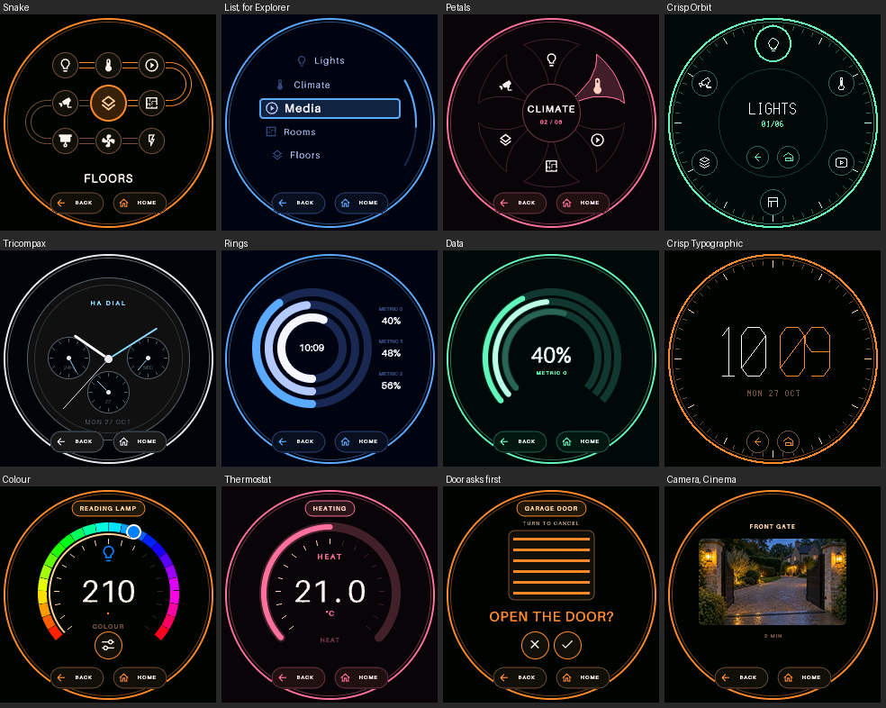

# HA Dial

Turn an [M5Stack Dial](https://docs.m5stack.com/en/homeassistant/devices/dial) into a physical control surface for Home Assistant.

You arrange pages and controls in a Home Assistant panel, and the Dial shows them on its round screen. Turn to move or adjust, press to act, and touch for anything the dial can't express. Changing what it controls never needs a firmware rebuild.



*Every screen above comes from the same renderer the Dial uses, with invented names.*

> **Status: prototype.** This is built and tested in development, but it's early. There's no HACS package or release yet, and much of it has only run against test stand-ins. See [What hasn't been proven yet](#what-hasnt-been-proven-yet).

## What it does

- **13 navigation styles**, from Orbit and Petals to List, Grid and Snake. See [Navigation styles](#navigation-styles).
- **19 watch, clock and data faces**, plus 3 camera styles, showing real sources from HA.
- **Controls for 23 kinds of entity**, with up to five styles each.
- **Explorer:** a page that fills itself from your floors, areas and entities.
- **Two drawing modes:** Smooth, and Crisp, which is built from line-step lines and circles.
- **Control over the details:** padding, sizes, gaps, widths, borders, positions and colours, with a live preview.
- **Dashboard cards** that show a Dial and operate it.
- **Local only:** no cloud, and no HA access token stored on the Dial.

## How it fits together

Home Assistant owns the meaning and the layout. It works out one finished screen, and the Dial and the browser both draw that same screen.

```text
HA Dial panel + Home Assistant state
                 │
                 ▼
      Page tree and navigation (HA)
                 │
                 ▼
          Scene compiler (HA)
            ┌────┴─────┐
            ▼          ▼
     Browser canvas   Dial
```

The Dial receives only what it needs: final geometry, colours, text masks and touch regions. It sends back what you did, and HA turns that into an action. [ARCHITECTURE.md](ARCHITECTURE.md) has the full design.

## Installation

You need an M5Stack Dial v1.1, Home Assistant with the ESPHome integration, and a Mac or Linux machine with Python 3.11 or later. It's developed against Home Assistant 2026.10.

### 1. Flash the firmware

```shell
python3 -m venv .venv
.venv/bin/pip install -e '.[dev]'
tools/flash /dev/cu.usbmodem… ha-dial-connected.yaml
```

Check which serial port is your Dial before flashing. If the first flash can't reset it, hold the StampS3's G0 button while reconnecting USB, release once it has power, and run the command again. After that you can update over the network:

```shell
tools/flash ha-dial.local ha-dial-connected.yaml
```

Each Dial needs its own ESPHome device name.

### 2. Install the integration

Copy `custom_components/ha_dial` into your HA config folder, or point the deploy tool at a mounted config share:

```shell
.venv/bin/python tools/deploy.py /path/to/ha/config
```

Restart Home Assistant. Later updates raise a Repair when a restart is needed. Refresh your browser after each one.

### 3. Connect everything

1. **Join Wi-Fi.** The Dial's **Needs Wi-Fi** screen shows its setup network, password and portal address. Join that network and enter your Wi-Fi details.
2. **Add the Dial to HA.** Go to **Settings → Devices & services → Add integration → ESPHome**, using the IP address the Dial shows. On the same network it's usually discovered automatically; across subnets or VLANs, adding it by hand is normal.
3. **Allow actions.** In the ESPHome device's options, enable **Allow the device to perform Home Assistant actions**. Without this, the Dial's input can't reach HA.
4. **Add HA Dial Server, once.** Go to **Settings → Devices & services → Add integration → HA Dial Server**. One server handles all your Dials.
5. **Refresh your browser.** **HA Dial** then appears in the sidebar, for administrators.
6. **Build your pages.** Open **HA Dial**, choose your Dial, add some pages and controls, then press **Save and apply**.

The Dial shows **Waiting for HA** until it has pages. That screen still mentions adding a dashboard card, but you don't need one.

## The panel

All editing happens in the **HA Dial** panel. Changes stay as a draft until you press **Save and apply**, and they're kept in your browser if you leave the page, so you can pick up where you left off. **Discard changes** drops them.

- **Pages and controls:** add pages, subpages and entities, and drag the handles to rearrange. Arrow keys on a handle move things too, and Left and Right change nesting.
- **Appearance:** choose a style and theme from galleries of live thumbnails, then adjust it under **Options**. Options only shows settings the current style actually uses, and only values you change are saved.
- **Visibility:** show a page or control only when conditions pass. You can use state, numeric state, time, template, and `and`, `or` and `not` groups. HA follows these by events. This isn't access control.
- **Dial settings:** the default theme, and an optional [page template](#page-templates).
- **Reset Dial:** removes that Dial's saved pages, after asking. Wi-Fi, pairing and firmware stay as they are.

### Try your Dial

The preview shows your draft exactly as the Dial will. Its **Zoom** slider enlarges the whole picture up to 400%, and you can drag to pan if it no longer fits.

Normally it's a **safe simulation**: controls respond on screen, but nothing real happens. It still reads live states, and opening a camera takes a real snapshot.

**Operate live house**, beside Save and Reset, makes the preview's controls operate your real devices, and a red banner warns you while it's on. It's off every time the panel opens. Your page edits still wait for Save.

## Navigation styles

Orbit, Pointer, Rolodex, Petals, Constellation, Compass, Ribbon, Breadcrumb, List, Grid, Pager, Needle and Snake.

A page can hold more than 8 items only in a style that scrolls or pages: **List, Grid, Snake, Compass, Ribbon, Rolodex or Pager**. The others show every item at once, so they stop at 8.

**Snake** lays icons in rows joined by one line, read in alternating directions. You can choose icons per row or spacing along the path, including on the returns, and set turn extension, a twist of the whole snake, single or double edges, and line colours.

## Explorer

Explorer builds pages from your home so you don't have to. It's an item, not a mode: choose **+ Explorer** on any page and it takes one slot beside your own items.

- **Structure:** floors, then areas, then your entities. A room with more than 8 entities splits into groups such as Lights and Climate. A lone floor and empty levels are skipped, and anything without an area goes in **Other devices**.
- **Coverage:** the whole home, one floor or one area.
- **What's included:** it follows HA's automatic dashboard rules, leaving out hidden, disabled, diagnostic and unsupported entities. The panel lists how many were left out and why. You can also limit it to entities exposed to Assist, which only reads those settings, and exclude individual entities.
- **Safety:** locks, alarms and garage, gate and door covers always ask for confirmation, and one switch leaves them all out.
- **Style:** any navigation style on pages of up to 8 items, with a separate scrolling style for longer ones. Tap a generated page to give it its own look. **Random** gives every page a different style, which stays put until you press **Shuffle styles**.
- **Cameras:** one setting for the style and picture treatment of all its cameras.

It rebuilds when your floors, areas or entities change, and if the page you're on disappears, the Dial returns to the nearest one that still exists.

## Controls

| Entity | Turning | Also |
| --- | --- | --- |
| Light | Brightness, white or colour | Press toggles. A button chooses what turning sets, offering only what the light supports |
| Switch | — | Press toggles |
| Cover | Position, if supported | Press stops. Open and close buttons |
| Climate | Target temperature | Mode controls |
| Media player | Volume | Transport buttons, where supported |
| Fan | Speed | Actions the fan supports |
| Number, select | Value or option | — |
| Lock, alarm | — | Actions always ask first. PIN-protected actions are unavailable, and no PIN is stored |
| Vacuum, timer | — | Actions they support |
| Scene, button | — | Activating asks first by default |
| Sensor, binary sensor, weather, calendar | — | Read-only |
| Camera, image | — | The picture, plus up to two action buttons in Portal |

Each has an **Instrument** graphic and a big-type **Editorial** style. Anything with a level also offers **Column**, **Segment** and **Tumbler**. Sensors can also use energy, air quality, water, vehicle and data graphics.

**Doors and gates** that need confirming show their state in words and ask in a large line, such as **OPEN THE DOOR?**. Turning the dial never moves them, and Stop always acts at once.

### How turning feels

From the first detent the Dial owns the value, and HA can't change the screen until they agree. The number and a slim gauge move straight away; bars and markers catch up when they agree.

| Setting | Default | What it does |
| --- | --- | --- |
| `value_settle` | 150 ms | No change for this long sends the value |
| `value_resend` | 1.5 s | HA hasn't acknowledged it, so send it again |
| `value_wait` | 10 s | HA has it but the device isn't there yet, so wait this long before resending |
| `value_resends` | 3 | After this many, HA wins and the Dial shows **NOT APPLIED** |

These are firmware settings on the `ha_dial:` component, so you can tune them for your network and devices. A slow blind may need a longer `value_wait`.

## Faces

Faces only show real sources. If a source isn't set or available, it shows `--`, and a chart without recorded history says **NO HISTORY**.

| Family | Styles | Updates |
| --- | --- | --- |
| Chronograph | Tricompax, Worldtimer, Skeleton, Moonphase | Every second |
| Ambient | Solar, Typographic, Orbital, Status | Every minute, and when a source changes |
| Watch | Contour, Modular, Palette, Rings, Solar, Reflections, Photos | Every minute, and when a source changes |
| Data | Area, Radar, Bands, Spark | Every minute, and when a source changes |

The page's **Options** ask for what its style reads, such as a time zone, weather entity, history window or metric sensors.

### Cameras and images

Add a camera or image entity to a page like any other entity, and choose **Portal**, **Cinema** or **Radar**. The **Photos** watch face shows one behind the time.

Each picture can be colour, mono, tint or dither, in either drawing mode. Pictures aren't a live feed: one is captured when you enter the page and when a bound entity fires, such as a motion sensor, or when an image entity updates. Otherwise it shows its age.

The Dial fetches pictures from HA's internal URL over **plain HTTP**, so it must be able to reach that address. If it can't, the page shows **NO LINK** and the preview says why.

## Crisp and Smooth

These are two drawing styles for lines and curves, and each page can choose one.

- **Smooth** anti-aliases every shape and uses a regular font.
- **Crisp** draws everything with line-step lines and midpoint circles, including its single-stroke capitals and line icons. Its fine lines show the algorithm's moiré on purpose. Text folds to capitals without accents, and characters outside its set appear as a box, so non-Latin labels don't read in Crisp.

## Dashboard cards

Add the **HA Dial** card to any dashboard to show a Dial and operate it. Cards can't edit anything, and HA refuses a save that doesn't come from the panel.

- **Dial:** which Dial it shows.
- **Follow the Dial's screen:** on, the card and the Dial show the same screen. Off, the card browses on its own, so using a dashboard doesn't disturb the Dial on the wall.

**Operating a card operates real devices**, for any HA user who can see it, except while the card is being added or edited, when its preview is safe. Its zoom slider starts at 100%, and each browser remembers the size for each Dial.

## Page templates

For repeatable trees, **Dial settings → Advanced** takes a Jinja template that returns a tree. It supports macros from HA's `custom_templates`, and HA follows the states it reads.

```jinja

{{ {'tree': {'id': 'home', 'title': 'Home', 'theme': theme, 'style': 'NAV-ORBIT',
    'items': [{'id': 'office', 'label': 'Office', 'theme': 'cobalt', 'children': lights}]}} | tojson }}
```

Leave out a control's profile and style to use its domain's defaults.

## Recovery and resets

Pages live in HA. The Dial keeps only what it's showing now, so it doesn't lose pages when reset, and HA sends the screen again when it reconnects.

| Action | Result |
| --- | --- |
| Restart the Dial or HA | Keeps Wi-Fi and saved pages |
| **Reset Dial** in the panel | Removes that Dial's pages. Wi-Fi, pairing and firmware stay |
| Hold the front button for 5–60 s, then release | Asks **Reset Wi-Fi?** Press to confirm, or turn or wait 15 s to cancel. Pages stay |
| ESPHome **Factory Reset** button | Erases the Dial's settings, including Wi-Fi. Pages stay. Disabled by default |
| Remove the Dial's ESPHome entry | Removes its connection. Pages stay |
| Remove HA Dial Server | **Deletes saved pages for all Dials.** Wi-Fi stays |

If Wi-Fi fails, the Dial reopens its setup portal after 30 seconds. **Show Settings**, an ESPHome switch that's off by default, adds a local page with IP, firmware version, uptime, signal and connection status. It works even when HA is down.

**Connection loss:** the Dial never keeps showing a stale control as live. It shows its setup screen, which says whether Wi-Fi, the ESPHome connection or the screen from HA is missing.

## What hasn't been proven yet

Most of this has been tested through automated checks, stand-ins for HA and comparisons of browser and firmware pixels, not long-term use in a real home. These especially need real-world testing:

- Explorer on a real home, including rebuilds and HA restarts.
- Pictures from real cameras, and the Dial reaching HA across subnets.
- White and colour on real lights, which round values differently.
- How turning feels on the Dial, and suitable values for its settings.
- Live operation from the preview, and Follow Dial turned off.
- Memory use and draw time on the Dial at its most complex screens.

## Development

```shell
.venv/bin/pytest -q                      # Python, browser and host C++ checks
tools/compile ha-dial-connected.yaml     # Full firmware build
.venv/bin/python tools/ux-gallery/server.py   # The design Atlas
```

Some C++ pixel checks need ArduinoJson from a firmware build, and they're skipped until you've run one.

| Path | Contents |
| --- | --- |
| `custom_components/ha_dial/` | The HA integration, panel and card |
| `components/ha_dial/` | The ESPHome component |
| `firmware/` | ESPHome configurations: hardware test and connected |
| `tests/` | Python tests, Node browser checks and host C++ checks |
| `tools/` | Compiling, flashing, deploying, versioning and the design Atlas |

The integration and firmware have separate versions, as `YYYY.M.R-bN` for builds. Bump the one you're changing before editing it:

```shell
.venv/bin/python tools/versioning.py bump integration
.venv/bin/python tools/versioning.py bump firmware
```

Notes go in [CHANGELOG.md](CHANGELOG.md) and [firmware/CHANGELOG.md](firmware/CHANGELOG.md). [BACKLOG.md](BACKLOG.md) has what's planned, and [AGENTS.md](AGENTS.md) records the project's design decisions and why they were made.

## Prior art

- [SmartHome-yourself/m5-dial-for-esphome](https://github.com/SmartHome-yourself/m5-dial-for-esphome)
- [samusamu81/M5Dial](https://github.com/samusamu81/M5Dial)
- [Jasionf/smart-home-button](https://github.com/Jasionf/smart-home-button)
- [Apfelsafft/m5dial](https://github.com/Apfelsafft/m5dial)
- [Skons/M5Dial](https://github.com/Skons/M5Dial)
- [M5Stack's Dial documentation](https://docs.m5stack.com/en/homeassistant/devices/dial)

## Licence

Licensed under the [MIT License](LICENSE).
